# INNEVA.E — AI Energy Intelligence Platform

**Historical electricity analytics, demand forecasting, local AI assistance, and operational monitoring for the Netherlands.**

INNEVA.E is a local-first energy intelligence portfolio project that combines public Dutch electricity and weather datasets with interactive analytics, experimental demand forecasts, AI-generated interpretations, and monitoring dashboards.

It demonstrates how energy data can be transformed into traceable insights for energy operations, planning, and analytical decision-making.

> **Project status:** Local development prototype. The application analyzes historical datasets and runs historical forecasting scenarios. It is not a live electricity market feed, an operational dispatch system, or a production-certified forecasting service.

## 1. Business Problem

Electricity operations require visibility into demand variability, renewable generation, wholesale market conditions, and data reliability.

These signals originate in different datasets, have different units, and may contain missing observations.

INNEVA.E integrates them into a reproducible analytical workflow and demonstrates how locally running AI can support interpretation and decision-making.

### Business Questions

- How does electricity demand vary across hours and days?
- What demand patterns might forecasting models anticipate?
- Can AI explain historical energy statistics and identify data quality concerns?
- How do machine-learning forecasts compare with simple benchmarks?
- Are analytical jobs, data checks, and forecasting processes completing successfully?

## 2. Platform Capabilities

| Module | Functionality |
|---|---|
| Energy Overview | Historical electricity demand, renewable generation, prices, and weather |
| Demand Forecasting | Experimental hourly electricity demand forecasts |
| Automated Forecasting | Forecast execution history and automated pipeline monitoring |
| Dynamic AI Analyst | Local AI assistant using verified energy analytics tools |
| AI Intelligence | AI-generated energy intelligence reports |
| Automation Monitoring | Historical agent execution records and validation outcomes |
| System Monitoring | Execution performance, success rates, and system analytics |
| Data Quality Monitoring | Dataset validation and missing-value assessments |
| Forecast Monitoring | Forecast accuracy, model benchmarking, and performance evaluation |

## 3. Application Demonstration

### 3.1 Dynamic AI Energy Analyst

The Dynamic AI Analyst uses a locally running Ollama model to interpret historical electricity data.

The assistant can execute constrained analytical tools:

- `get_energy_overview`
- `get_data_quality`
- `forecast_next_hour`

The application displays execution details, selected tools, and automated validation results.

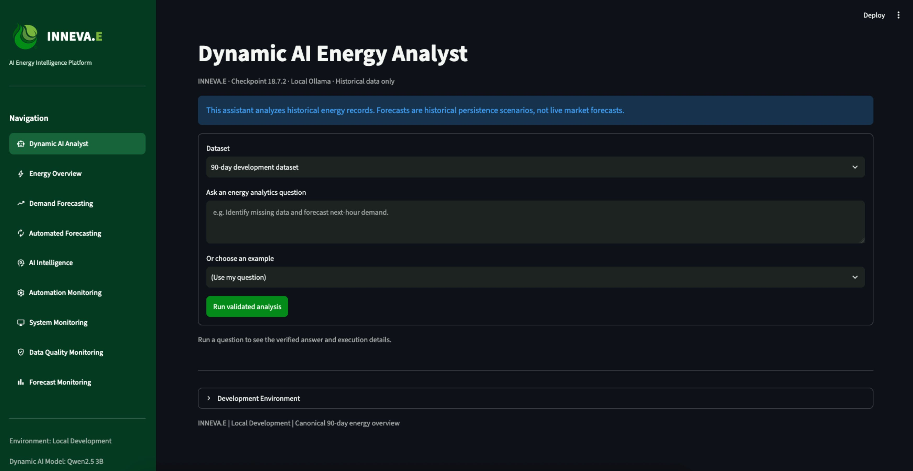

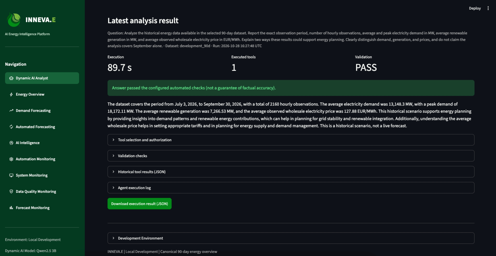

**Example business scenario**

For the 90-day historical period from July 3 to September 30, 2026, the agent reported:

| Metric | Result |
|---|---:|
| Hourly observations | 2,160 |
| Average electricity demand | 13,148.3 MW |
| Peak electricity demand | 18,172.11 MW |
| Average renewable generation | 7,266.53 MW |
| Average observed wholesale electricity price | €127.88/MWh |

These values describe the selected 90-day dataset, not September alone.

### 3.2 Historical Energy Overview

The Energy Overview dashboard allows users to explore historical electricity demand, renewable generation, wholesale prices, and weather conditions.

It provides interactive visualizations, historical date selection, summary statistics, and downloadable datasets.

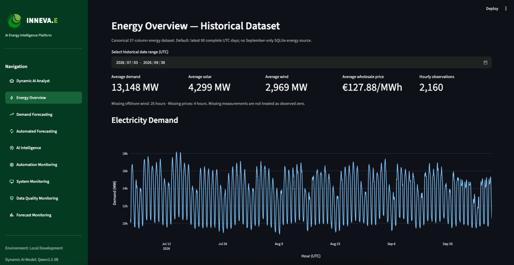

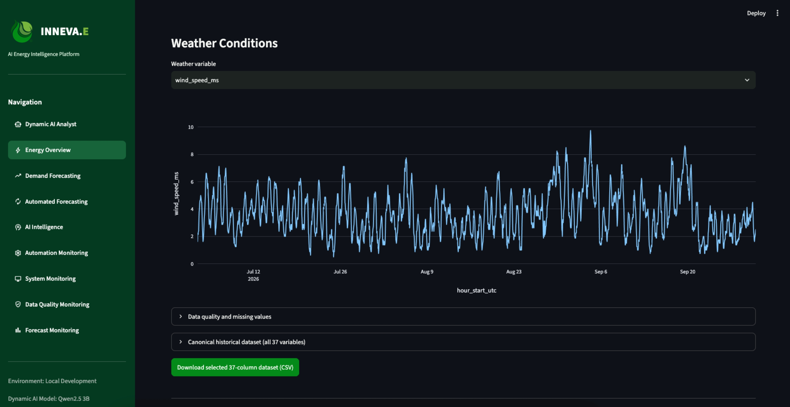

### 3.3 Electricity Demand Forecasting

INNEVA.E includes an experimental forecasting engine supporting different forecasting horizons and methods.

The platform generates hourly electricity demand predictions and presents results through interactive charts.

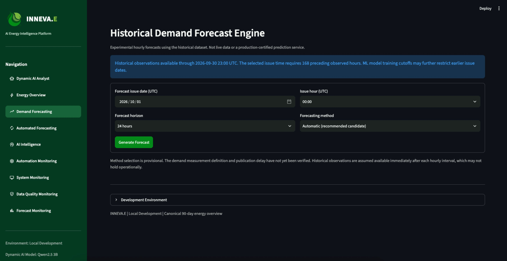

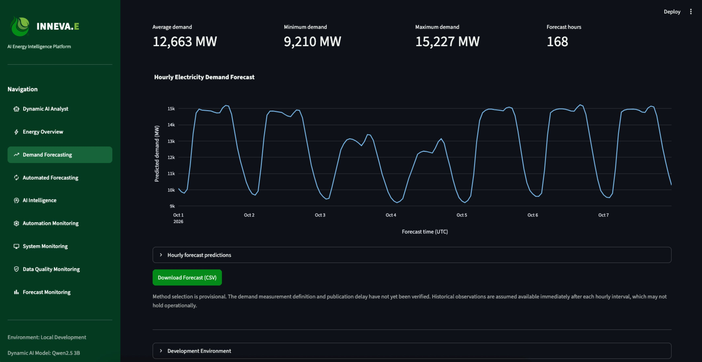

**Example: Seven-day demand forecast**

| Metric | Result |
|---|---:|
| Forecast period | October 1–7, 2026 |
| Forecast horizon | 168 hours |
| Minimum predicted demand | 9,210 MW |
| Maximum predicted demand | 15,227 MW |

These are historical forecasting scenario outputs, not observed future electricity demand.

### 3.4 Automated Forecasting

The Automated Forecasting module supports the execution and monitoring of forecasting workflows.

Its interface includes:

- Latest automated forecast results
- Hourly demand predictions
- Forecast execution history
- Pipeline execution status
- Downloadable forecast outputs

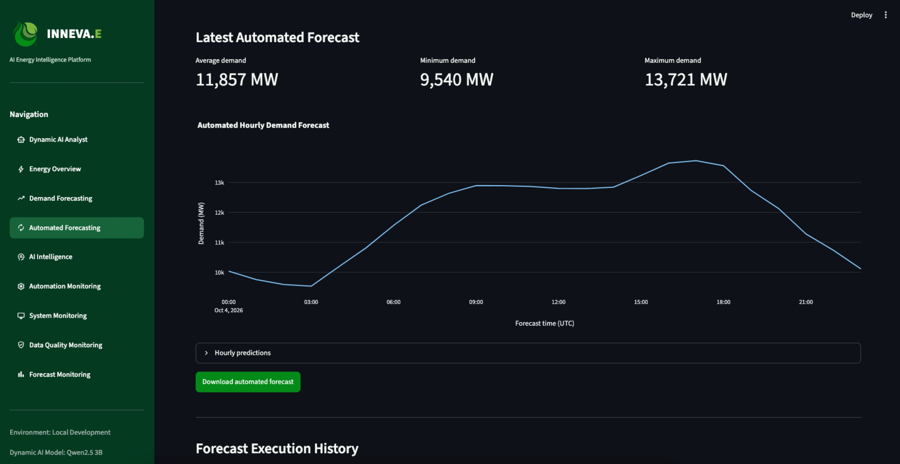

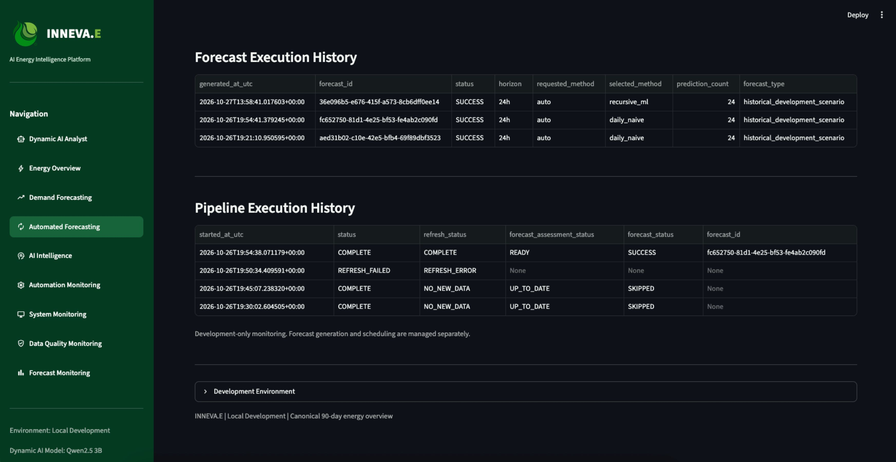

### 3.5 AI Intelligence Reports

The AI Intelligence module transforms historical analytical information into structured narrative reports.

It provides locally generated reports, structured JSON outputs, historical report exploration, and report metadata.

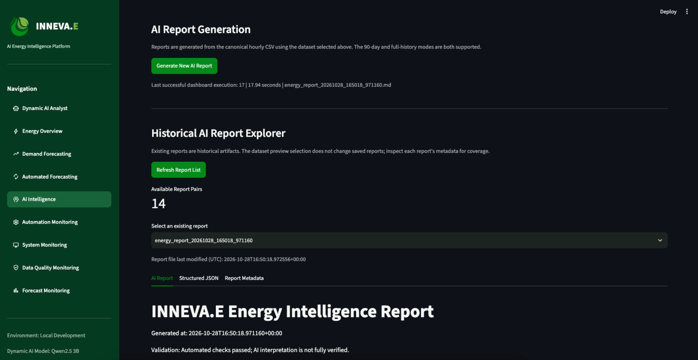

AI-generated interpretations remain subject to human review, even when automated validation checks pass.

### 3.6 Automation Monitoring

The Automation Monitoring module records historical AI agent executions.

Users can inspect execution status, duration, selected tools, validation results, and individual execution records.

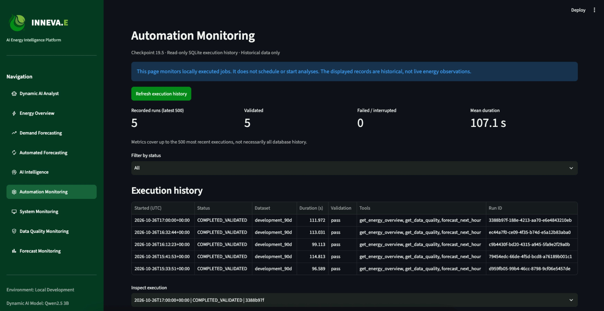

### 3.7 System Monitoring

The System Monitoring module provides operational visibility into recorded automation executions.

It includes success-rate indicators, execution distributions, execution duration analysis, and historical performance trends.

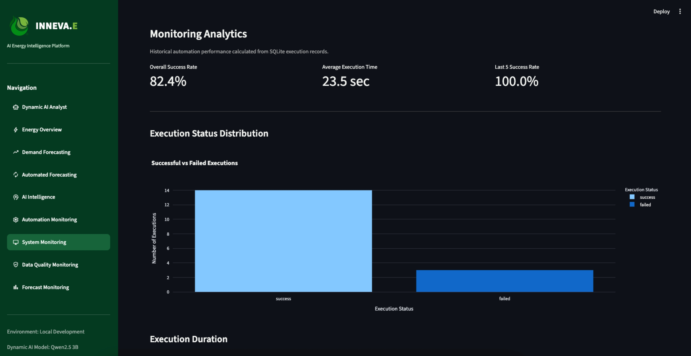

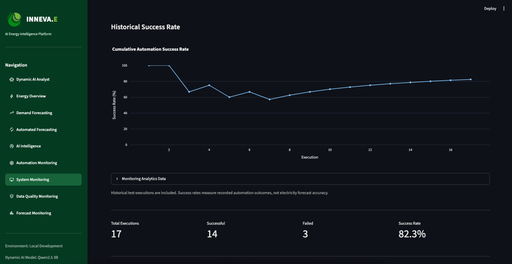

Automation success rates describe recorded execution outcomes, not electricity forecast accuracy.

### 3.8 Data Quality Monitoring

The Data Quality Monitoring module assesses dataset completeness and identifies potential issues before analytical processing.

It displays dataset coverage, missing observations, validation warnings, and historical assessments.

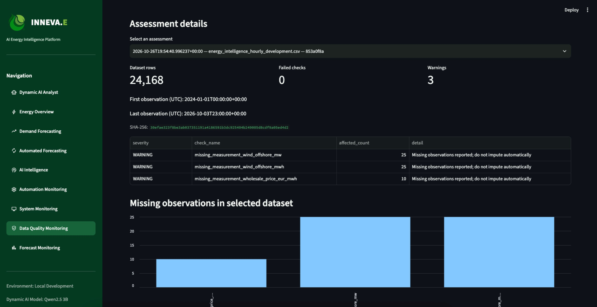

A displayed development dataset assessment covers 24,168 hourly records and identifies missing offshore wind generation and wholesale electricity price observations.

The development dataset is separate from the canonical historical dataset.

### 3.9 Forecast Monitoring and Model Benchmarking

The Forecast Monitoring module evaluates electricity demand predictions against observed values.

It supports several forecasting performance metrics:

- MAE — Mean Absolute Error
- RMSE — Root Mean Squared Error
- MAPE — Mean Absolute Percentage Error
- Bias — Average signed forecast error

It also compares machine-learning methods with baseline forecasting approaches.

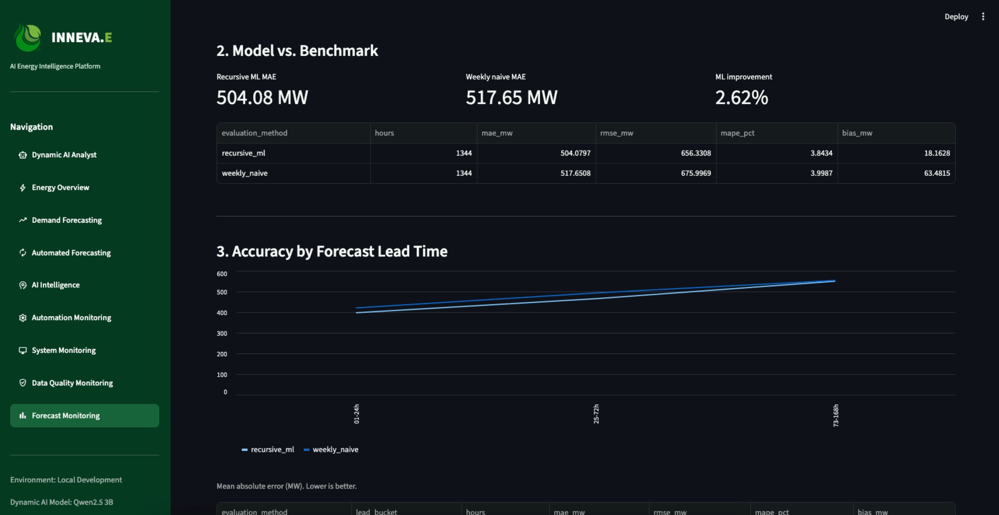

**Example historical model evaluation**

| Metric | Recursive ML | Weekly Naive |
|---|---:|---:|
| Evaluated hours | 1,344 | 1,344 |
| MAE | 504.08 MW | 517.65 MW |
| RMSE | 656.33 MW | 676.00 MW |
| MAPE | 3.84% | 4.00% |

In this particular evaluation, recursive ML achieved approximately **2.62% lower MAE** than the weekly-naive benchmark.

This result applies only to the evaluated historical dataset and should not be interpreted as a general performance guarantee.

## 4. Data Sources

INNEVA.E uses publicly available electricity and weather datasets from established energy and meteorological organizations.

| Provider | Dataset | Source |
|---|---|---|
| Nationaal Energie Dashboard (NED) | Electricity demand and renewable generation | https://ned.nl/nl/dataportaal/energie-consumptie/elektriciteit |
| KNMI | Hourly meteorological observations | https://www.knmi.nl/nederland-nu/klimatologie/uurgegevens |
| Netbeheer Nederland | Grid capacity and congestion information | https://capaciteitskaart.netbeheernederland.nl/info/algemene-info/ |
| Ember | Wholesale electricity prices | https://ember-energy.org/data/european-wholesale-electricity-price-data/ |

### Canonical Historical Dataset

The primary analytical dataset contains:

- 24,096 hourly records
- 37 variables
- January 1, 2024 – September 30, 2026
- Electricity demand and renewable generation
- Wholesale electricity prices
- Weather measurements
- Missing-data indicators
- Calendar and time features

A separate development dataset contains 24,168 hourly records and extends through October 3, 2026, including development-only data.

The project maintains separate raw, working, and processed datasets to support reproducibility.

## 5. Technology Stack

| Category | Technologies |
|---|---|
| Programming | Python |
| Data processing | Pandas, NumPy |
| Data storage | CSV, SQLite |
| Forecasting | Machine learning and statistical baselines |
| AI integration | Ollama, Qwen |
| Application | Streamlit |
| Visualization | Interactive Python dashboard charts |
| Development | VS Code, Git, Python virtual environments |
| Operating environment | Local macOS development |

## 6. System Architecture

```text
         PUBLIC ENERGY DATA SOURCES
                    |
        NED / KNMI / EMBER / GRID
                    |
                    v
             RAW DATA LAYER
                    |
                    v
          DATA PREPARATION LAYER
                    |
                    v
       CANONICAL HOURLY DATASET
                    |
       +------------+------------+
       |            |            |
       v            v            v
  HISTORICAL    FORECASTING   DATA QUALITY
   ANALYTICS       ENGINE      VALIDATION
       |            |            |
       +------------+------------+
                    |
                    v
           ENERGY ANALYTICS TOOLS
                    |
                    v
             LOCAL AI AGENT
              OLLAMA / QWEN
                    |
                    v
          AI INTERPRETATION AND
          INTELLIGENCE REPORTS
                    |
                    v
           MONITORING MODULES
                    |
                    v
           STREAMLIT DASHBOARD
```

This is a conceptual architecture. The modules do not necessarily operate continuously or refresh source data automatically.

## 7. Local Installation

### Requirements

- Python 3.12-compatible environment
- Git
- Python virtual environment
- Ollama for AI-enabled functionality
- Required local AI models

### Installation

Clone the repository:

```bash
git clone YOUR_REPOSITORY_URL
cd INNEVAE
```

Create a virtual environment:

```bash
python3 -m venv .venv
source .venv/bin/activate
```

Install dependencies:

```bash
python -m pip install -r requirements.txt
```

Start Ollama and ensure the required Qwen models are installed.

Launch the Streamlit application:

```bash
streamlit run src/dashboard/app.py
```

**Note:** Replace the repository URL and Streamlit entrypoint placeholder with the verified values from your local project before publishing.

## 8. Project Limitations

INNEVA.E is a local development and portfolio prototype.

Current limitations include:

- Historical datasets rather than live electricity market feeds
- Experimental forecasting models
- Missing measurements in selected source datasets
- AI-generated explanations requiring human verification
- Forecasting performance dependent on the evaluation period
- No production-certified forecasting or operational dispatch functionality

Forecast issue times, forecast target timestamps, and observed electricity demand must be interpreted separately.

## 9. Future Development

Potential extensions include:

- Additional rolling historical backtests
- Improved forecasting models and feature engineering
- More comprehensive AI report validation
- Automated data refresh workflows
- Enhanced forecasting drift monitoring
- Secured cloud deployment
- Integration with additional European electricity market datasets

## 10. Project Objective

INNEVA.E demonstrates the integration of:

**Business Analytics + Energy Intelligence + Python Development + Machine Learning + Local AI + Operational Monitoring**

The project illustrates how analytical tools can support data-driven decisions while incorporating data quality, explainability, reproducibility, and performance evaluation.

---

**INNEVA.E | AI Energy Intelligence Platform**

*Local-first development project using historical electricity and weather datasets.*
